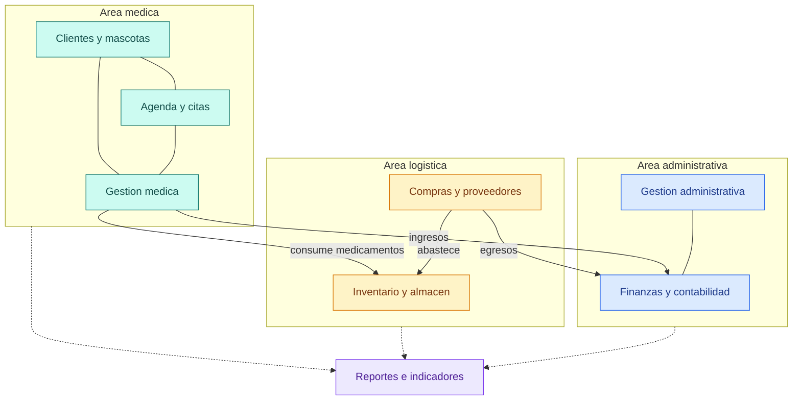

# VetCore ERP

Sistema ERP modular para clínicas veterinarias. Reúne la gestión médica y administrativa en una sola plataforma para reducir la pérdida de información, la duplicidad de registros y los errores en el control de medicamentos.

Proyecto académico desarrollado por el equipo IntegraSoft.

## Contenido

- [El problema](#el-problema)
- [La solución](#la-solución)
- [Módulos](#módulos)
- [Cómo se relacionan los módulos](#cómo-se-relacionan-los-módulos)
- [Alcance del proyecto](#alcance-del-proyecto)
- [Equipo](#equipo)

## El problema

Algunas clínicas veterinarias tienen dificultades para administrar:

| Área | Dificultad | Consecuencia posible |
|---|---|---|
| Clientes y mascotas | Información dispersa | Pérdida de información |
| Historiales médicos | Seguimiento poco ordenado | Registros duplicados |
| Citas | Programación manual | Errores administrativos |
| Inventario | Poco control de medicamentos | Faltantes y errores |
| Finanzas | Datos sin centralizar | Decisiones difíciles de tomar |

## La solución

VetCore ERP está pensado para resolver estos inconvenientes. Cada área de la clínica se gestiona de forma organizada y conectada con las demás, lo que evita duplicar información y mejora la comunicación entre los procesos médicos y los administrativos.

## Módulos

1. **Gestión de clientes y mascotas.** Datos de los dueños y de sus mascotas.
2. **Gestión médica veterinaria.** Historiales médicos y seguimiento clínico.
3. **Agenda y citas.** Programación de citas.
4. **Inventario y almacén.** Control de existencias y medicamentos.
5. **Compras y proveedores.** Abastecimiento y relación con proveedores.
6. **Gestión financiera y contabilidad.** Control financiero y contable.
7. **Gestión administrativa.** Administración general de la clínica.
8. **Reportes e indicadores.** Información para evaluar el funcionamiento del negocio y detectar oportunidades de mejora.

## Cómo se relacionan los módulos

Esquema conceptual. No es todavía un diseño técnico definitivo.

## Alcance del proyecto

El desarrollo parte de las funcionalidades esenciales y se ampliará de forma progresiva con nuevas características, según las necesidades de la clínica. También se contempla la generación de reportes que ayuden a evaluar el negocio y a detectar oportunidades de mejora.

## Equipo

IntegraSoft

- Leonardo Cruz
- Henry Ariel Ramírez
- Santiago Vásconez

---

VetCore ERP busca contribuir a la modernización y eficiencia de las clínicas veterinarias, con una herramienta que integre sus principales procesos en un solo sistema.
